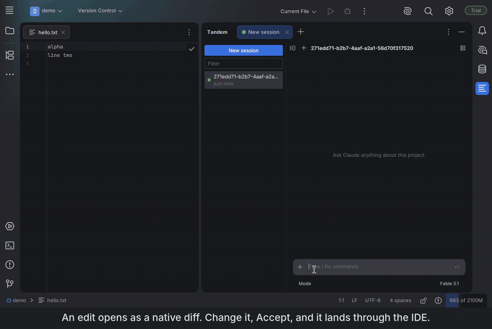

[English](README.md) | [简体中文](README.zh-CN.md) | **日本語** | [한국어](README.ko.md)

# Tandem

Claude Code 向けの、高速でネイティブな JetBrains プラグインです。無料かつオープンソースです。



> ステータス：初期段階。0.4.1 から [JetBrains Marketplace](https://plugins.jetbrains.com/plugin/35641-tandem) で公開しています。
> 現在は macOS と Linux に対応しており、Windows は対応作業中です。
> 編集は IDE を通して行われます。Tandem では CLI 自身の Edit ツールと Write ツールを無効にし、代わりに独自のツールを提供しています。編集できる差分は、実際の記録を再生するフェイク CLI でテストし、macOS では手動でも確認していますが、粗削りな部分はまだあるものと考えてください。

## なぜ Tandem か
- **ネイティブ UI。** 組み込みブラウザーではなく、IDE 自体のツールキットである Jewel（Compose）で作られています。
- **Node も同梱 SDK も不要。** Tandem はすでにお使いの `claude` CLI を直接動かすので、新しいモデルや機能は CLI がリリースしたその日から使えます。
- **編集は IDE を通して。** Claude が提案する編集はすべて、書き込まれる前に IDE 標準の差分ビューで開き、そこで提案の内容を手で修正することもできます。Accept を押すと、編集はエディターを通して適用され、あなたの修正も含めたファイルの現在の内容が Claude に伝わります。Reject を押すと、その理由が Claude に送られます。Accept edits モードにするか、差分ビューで Accept all を選ぶ（そのターンの残りの間有効）と、差分ビューは表示されなくなります。
- **ありのままの状態表示。** 選んだモデルが使えず CLI が別のモデルにフォールバックしたときは、そのことがそのまま表示されます。
- **サインインは CLI に任せたまま。** Tandem は認証情報や API キーを一切読みません。

## できること
- **IDE の一部として動くチャットツールウィンドウ。** セッションはサイドバーに並び、実行中のセッションごとにタブが 1 つ開きます。名前の変更、フォーク、削除ができ、ターミナルで始めたセッションもサイドバーに現れて、CLI 自身の `--resume` で再開できます。
- **編集できる差分。** Ctrl+S（⌘S）で承認します。書き込みはディスクに直接ではなく必ずエディターを通るため、アンドゥ、ローカル履歴、未保存のバッファーがそのまま機能します。
- **モデル、エフォート、権限モードのピッカーと、ありのままの表示。** Tandem は CLI が報告するモデルを確認し、選んだものと違うときやフォールバックしたときはチャットでそう伝えます。Shift+Tab で権限モードを順に切り替えられます。
- **権限カード、質問、MCP サーバー、スラッシュコマンド、`! command`。** チャット内でツール呼び出しを承認し、Claude の質問に答え、パネルから MCP サーバーのオン・オフやサインインを行い、出力を Claude に渡すシェルコマンドを実行できます。
- **見えるコンテキスト。** `@` でプロジェクトのファイルを未保存の変更ごと選べ、エディターの選択範囲はチップとして一緒に送られます。コンテキストリングからはコンテキストウィンドウの内訳を開け、`/usage` はセッションのコストとプランの利用上限を表示します。
- **Claude の作業中でも送信、またはターン終了後に送るようキューに追加**（Ctrl+Enter、⌘↵）。キューに入れたメッセージは編集やキャンセルができます。

## 仕組み
Tandem は、インストール済みの `claude` バイナリを `--output-format stream-json --input-format stream-json` を付けて起動し、ストリームされてくる内容を Jewel で描画します。編集ツールは SDK MCP サーバーとして実装されていて、CLI は同じ制御チャネル経由でそこに到達します。ほかには何も動きません。Node も、サイドカーも、ブラウザーもありません。[docs/protocol.md](docs/protocol.md) では、CLI が実際にやり取りしているとおりのプロトコルを説明しています。

## サイズ
0.4.1 の ZIP は 4.0 MB で、中身は jar 4 つです。Node も webview もネイティブライブラリもありません。Marketplace の ZIP を測定するスクリプトと、Claude Code 向けのほかのプラグインの数値は [docs/benchmarks.md](docs/benchmarks.md) にあります。IDE テストでは、サイドバーから 1000 ターンの会話を開くのに 1.4 秒かかり、UI のフリーズはありません（同じドキュメント参照）。最初のトークンまでの時間とメモリ使用量はまだ測定していません。

## 動作要件
- JetBrains IDE 2026.1 以降。
- [Claude Code](https://code.claude.com) をインストールしてサインイン済みであること（ターミナルで `claude --version` が通ること）。

### 中継サーバーやサードパーティのエンドポイントを使う
Tandem は、インストールされた `claude` を、ターミナルで CLI が見ているのと同じ環境で起動します。そのため、CLI 側にすでにある設定がそのまま適用されます。サインインはもちろん、`~/.claude/settings.json` の `env` に設定した、あるいはシェルで export した `ANTHROPIC_BASE_URL` と `ANTHROPIC_AUTH_TOKEN` も同様です。Tandem 自体にはプロバイダーの設定がなく、これらの値を読むこともありません。`settings.json` を書き換えて CLI のプロバイダーを切り替えるツールを使った場合、その変更は次にセッションを開始したときに反映されます。

ネイティブインストーラーのダウンロードがうまくいかない環境でも、npm なら CLI をインストールできます。
```bash
npm install -g @anthropic-ai/claude-code
```

Tandem のピッカーとフッターに表示されるモデルは、CLI が報告してきたものです。モデル名を別の名前に対応付ける中継サーバーを使っている場合も、表示されるのは CLI が報告する名前です。

## インストール
Settings | Plugins | Marketplace で **Tandem** を検索するか、[plugins.jetbrains.com/plugin/35641-tandem](https://plugins.jetbrains.com/plugin/35641-tandem) を開きます。その後、Tandem ツールウィンドウを開いてプロンプトを入力してください。

## ソースからビルド
```bash
./gradlew runIde        # プラグイン入りのサンドボックス IDE
./gradlew test          # ユニットテストとプロトコルのフィクスチャテスト
./gradlew buildPlugin   # build/distributions/ に ZIP を出力
```
ZIP は Settings | Plugins | ⚙ | Install Plugin from Disk でインストールします。

## Claude Code で Tandem を開発する
まず `./scripts/setup-agent.sh` を一度実行してください。このリポジトリが前提とするプラグイン、言語サーバー、ドキュメントサーバーがインストールされます。その後、`CLAUDE.md`、`docs/design.md`、`docs/protocol.md` を読んでください。

## ライセンス
Apache 2.0。Tandem は独立したプロジェクトであり、Anthropic や JetBrains とは提携しておらず、承認も受けていません。
Claude および Claude Code は Anthropic, PBC の商標です。
