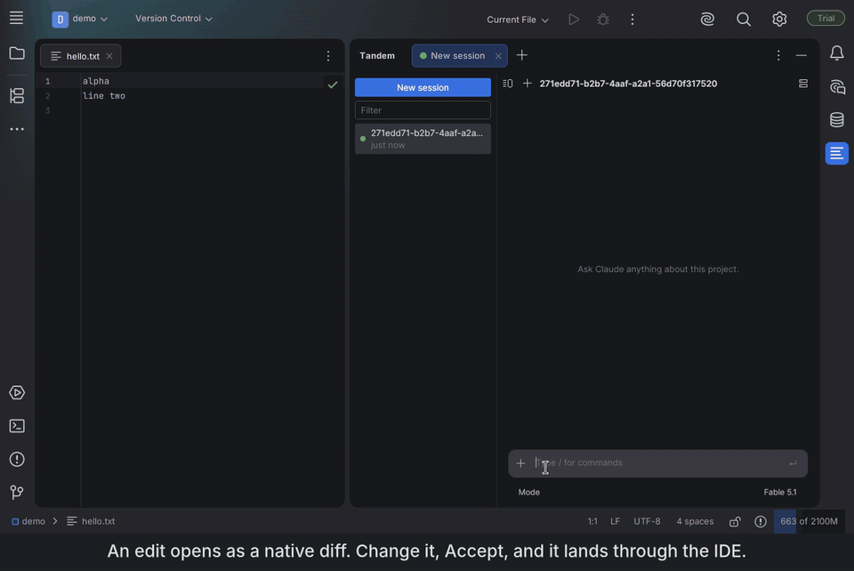

[English](README.md) | [简体中文](README.zh-CN.md) | [日本語](README.ja.md) | **한국어**

# Tandem

Claude Code용 빠른 네이티브 JetBrains 플러그인입니다. 무료이며 오픈 소스입니다.



> 상태: 초기 단계. 0.4.1부터 [JetBrains Marketplace](https://plugins.jetbrains.com/plugin/35641-tandem)에 올라와 있습니다.
> 현재 macOS와 Linux를 지원하며, Windows 지원은 작업 중입니다.
> 편집은 IDE를 거칩니다. Tandem에서는 CLI에 내장된 Edit 및 Write 도구가 비활성화되고, 그 자리를 Tandem의 편집 도구가 대신합니다. 편집 가능한 diff는 실제 녹화본을 재생하는 가짜 CLI로 테스트했고 macOS에서 직접 확인했지만, 아직 다듬어지지 않은 부분이 있을 수 있습니다.

## 왜 Tandem인가
- **네이티브 UI.** 내장 브라우저가 아니라 IDE 자체 툴킷인 Jewel(Compose)로 만들었습니다.
- **Node도, 번들 SDK도 없습니다.** Tandem은 이미 설치해 둔 `claude` CLI를 직접 구동하므로, 새 모델과 기능도 CLI에 추가되는 그날 바로 쓸 수 있습니다.
- **편집은 IDE를 통해.** Claude가 제안하는 모든 편집은 파일에 쓰이기 전에 IDE 자체의 diff로 열리며, 거기서 제안을 직접 고칠 수 있습니다. Accept는 에디터를 통해 편집을 적용하고, 사용자가 고친 부분까지 포함해 파일의 현재 내용을 Claude에게 알려 줍니다. Reject는 사용자가 적은 이유를 Claude에게 보냅니다. Accept edits 모드를 켜거나 diff에서 Accept all을 누르면(그 턴이 끝날 때까지) diff를 건너뜁니다.
- **정직한 상태 표시.** 선택한 모델을 쓸 수 없어 CLI가 다른 모델로 폴백하면 그 사실이 그대로 표시됩니다.
- **로그인은 CLI가 관리합니다.** Tandem은 자격 증명이나 API 키를 절대 읽지 않습니다.

## 제공 기능
- **IDE 안에 자리 잡은 채팅 도구 창.** 세션은 사이드바에 있고, 실행 중인 세션마다 탭이 하나씩 열립니다. 이름 변경, 포크, 삭제가 가능하며, 터미널에서 시작한 세션도 사이드바에 나타나 CLI 자체의 `--resume`으로 재개됩니다.
- **편집 가능한 diff.** Ctrl+S(⌘S)로 수락합니다. 파일 쓰기가 디스크로 직접 가지 않고 항상 에디터를 거치므로 실행 취소, 로컬 히스토리, 저장하지 않은 버퍼가 그대로 작동합니다.
- **실제 상태를 그대로 보여 주는 모델, 추론 강도, 권한 모드 선택기.** Tandem은 CLI가 보고하는 모델을 확인하고, 선택한 모델과 다르거나 폴백했으면 채팅에서 알려 줍니다. Shift+Tab으로 권한 모드를 차례로 전환합니다.
- **권한 카드, 질문, MCP 서버, 슬래시 명령, `! command`.** 채팅에서 도구 호출을 승인하고, Claude의 질문에 답하고, 패널에서 MCP 서버를 켜고 끄거나 로그인하고, 출력이 Claude에게 전달되는 셸 명령을 실행할 수 있습니다.
- **눈에 보이는 컨텍스트.** `@`로 프로젝트 파일을 고를 수 있고(저장하지 않은 변경 포함), 에디터에서 선택한 영역은 칩으로 함께 전송됩니다. 컨텍스트 링을 누르면 컨텍스트 윈도우의 구성 내역이 열리고, `/usage`는 세션 비용과 요금제 한도를 보여 줍니다.
- **Claude가 작업하는 중에도 보내거나, 턴이 끝난 뒤에 보내도록 대기열에 넣기**(Ctrl+Enter, ⌘↵). 대기 중인 메시지는 수정하거나 취소할 수 있습니다.

## 작동 방식
Tandem은 사용자가 설치한 `claude` 바이너리를 `--output-format stream-json --input-format stream-json` 옵션으로 실행하고, 스트리밍되어 오는 내용을 Jewel로 렌더링합니다. Tandem의 편집 도구는 SDK MCP 서버로, CLI가 같은 제어 채널을 통해 접근합니다. 그 밖에 실행되는 것은 없습니다. Node도, 사이드카도, 브라우저도 없습니다. [docs/protocol.md](docs/protocol.md)는 CLI가 실제로 사용하는 프로토콜을 있는 그대로 설명합니다.

## 크기
0.4.1 ZIP은 4.0 MB로, jar 4개뿐이며 Node, webview, 네이티브 라이브러리는 없습니다. Marketplace ZIP을 측정하는 스크립트와 다른 Claude Code용 플러그인들의 수치는 [docs/benchmarks.md](docs/benchmarks.md)에 있습니다. IDE 테스트에서 사이드바로 1000턴짜리 대화를 여는 데 1.4초가 걸리고, UI 멈춤은 없습니다(같은 문서 참고). 첫 토큰까지의 시간과 메모리 사용량은 아직 측정하지 않았습니다.

## 요구 사항
- JetBrains IDE 2026.1 이상.
- [Claude Code](https://code.claude.com) 설치 및 로그인(터미널에서 `claude --version`이 동작해야 합니다).

### 릴레이 또는 서드파티 엔드포인트 사용
Tandem은 설치된 `claude`를 터미널에서와 같은 환경으로 실행합니다. 따라서 CLI에 이미 해 둔 설정이 그대로 적용됩니다. 로그인이든, `~/.claude/settings.json`의 `env`에 넣거나 셸에서 export한 `ANTHROPIC_BASE_URL`과 `ANTHROPIC_AUTH_TOKEN`이든 마찬가지입니다. Tandem에는 별도의 공급자 설정이 없고, 이 값들을 읽지도 않습니다. `settings.json`을 고쳐 써서 CLI의 공급자를 바꾸는 도구를 쓰면, 변경 내용은 다음 세션을 시작할 때 적용됩니다.

네이티브 설치 프로그램을 다운로드할 수 없는 환경에서는 npm으로 CLI를 설치할 수 있습니다.
```bash
npm install -g @anthropic-ai/claude-code
```

Tandem의 선택기와 하단 표시줄에 표시되는 모델은 CLI가 보고하는 모델입니다. 모델 이름을 매핑하는 릴레이를 쓰면 CLI가 보고하는 이름이 그대로 표시됩니다.

## 설치
Settings | Plugins | Marketplace에서 **Tandem**을 검색하거나 [plugins.jetbrains.com/plugin/35641-tandem](https://plugins.jetbrains.com/plugin/35641-tandem)을 엽니다. 그런 다음 Tandem 도구 창을 열고 프롬프트를 입력하면 됩니다.

## 소스에서 빌드
```bash
./gradlew runIde        # 플러그인이 설치된 샌드박스 IDE
./gradlew test          # 단위 테스트와 프로토콜 fixture 테스트
./gradlew buildPlugin   # build/distributions/에 ZIP 생성
```
ZIP은 Settings | Plugins | ⚙ | Install Plugin from Disk로 설치합니다.

## Claude Code로 Tandem 개발하기
`./scripts/setup-agent.sh`를 한 번 실행합니다. 이 저장소에 필요한 플러그인, 언어 서버, 문서 서버가 설치됩니다. 그런 다음 `CLAUDE.md`, `docs/design.md`, `docs/protocol.md`를 읽습니다.

## 라이선스
Apache 2.0. Tandem은 Anthropic이나 JetBrains와 제휴하거나 보증을 받은 바 없는 독립 프로젝트입니다.
Claude 및 Claude Code는 Anthropic, PBC의 상표입니다.
