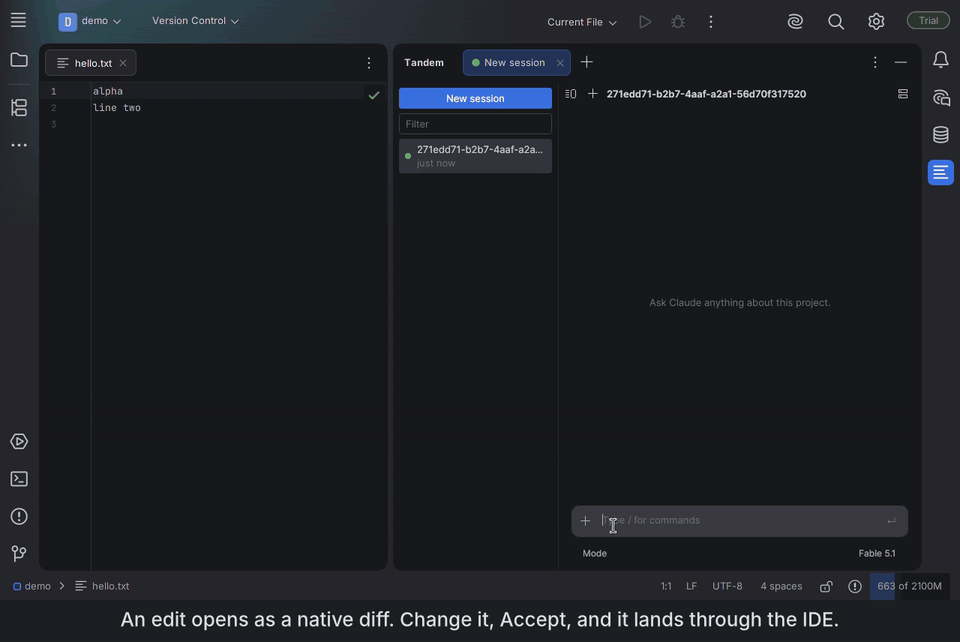

**English** | [简体中文](README.zh-CN.md) | [日本語](README.ja.md) | [한국어](README.ko.md)

# Tandem

A fast, native JetBrains plugin for Claude Code. Free and open source.



> Status: early. On the [JetBrains Marketplace](https://plugins.jetbrains.com/plugin/35641-tandem) since 0.4.1.
> macOS and Linux today; Windows in progress.
> Edits go through the IDE: the CLI's own Edit and Write tools are disabled in Tandem, which serves its own. The editable
> diff is tested against a fake CLI that replays real recordings and by hand on macOS; expect rough edges.

## Why
- **Native UI.** Built with Jewel (Compose), the IDE's own toolkit, not an embedded browser.
- **No Node, no bundled SDK.** Tandem drives the `claude` CLI you already have, so new models and features
  work the day the CLI ships them.
- **Edits through the IDE.** Every edit Claude proposes opens in the IDE's own diff before it is written, and you can
  change the proposal by hand there. Accept applies it through the editor and tells Claude what the file now says,
  your changes included; Reject sends your reason. The Accept edits mode, or Accept all in a diff (for the rest of
  that turn), skips the diff.
- **Honest status.** If your model is unavailable and the CLI falls back to another, you see it.
- **Your sign-in stays with the CLI.** Tandem never reads credentials or API keys.

## What you get
- **A chat tool window that is part of the IDE.** Sessions in a sidebar, one tab per live session; rename, fork and
  delete; a session started in a terminal shows up in the sidebar and resumes with the CLI's own `--resume`.
- **The editable diff.** Accept with Ctrl+S (⌘S); undo, local history and unsaved buffers work because the write goes
  through the editor, never straight to disk.
- **Pickers for model, effort and permission mode, with the truth shown.** Tandem checks the model the CLI reports
  and says so in the chat when it differs or falls back; Shift+Tab cycles the permission mode.
- **Permission cards, questions, MCP servers, slash commands, `! command`.** Approve a tool call in the chat, answer
  Claude's questions, toggle and sign in to MCP servers from a panel, run a shell command whose output goes to Claude.
- **Context you can see.** `@` picks a project file (unsaved changes included), the editor's selection rides along
  as a chip, the context ring opens a breakdown of the window, and `/usage` shows the session's cost and your plan's
  limits.
- **Send while Claude works, or queue for after the turn** (Ctrl+Enter, ⌘↵); queued messages can be edited or cancelled.

## How it works
Tandem starts the `claude` binary you installed, with `--output-format stream-json --input-format stream-json`, and
renders what it streams with Jewel. Its edit tools are an SDK MCP server that the CLI reaches over the same control
channel. Nothing else runs: no Node, no sidecar, no browser. [docs/protocol.md](docs/protocol.md) describes the protocol
as the CLI really speaks it.

## Size
The 0.4.1 ZIP is 4.0 MB: four jars, no Node, no webview, no native libraries. The script that measures Marketplace ZIPs,
and the numbers for the other plugins for Claude Code, are in [docs/benchmarks.md](docs/benchmarks.md). Opening a
1000-turn conversation from the sidebar takes 1.4 s in the IDE test, with no UI freeze; that measurement is in the same document. Time to first
token and memory are not measured yet.

## Requirements
- A JetBrains IDE, 2026.1 or newer.
- [Claude Code](https://code.claude.com) installed and signed in (`claude --version` works in a terminal).

## Install
Settings | Plugins | Marketplace, search for **Tandem**, or open
[plugins.jetbrains.com/plugin/35641-tandem](https://plugins.jetbrains.com/plugin/35641-tandem). Then open the Tandem tool
window and type a prompt.

## Build from source
```bash
./gradlew runIde        # sandbox IDE with the plugin
./gradlew test          # unit and protocol fixture tests
./gradlew buildPlugin   # ZIP in build/distributions/
```
Install the ZIP with Settings | Plugins | ⚙ | Install Plugin from Disk.

## Working on Tandem with Claude Code
Run `./scripts/setup-agent.sh` once. It installs the plugins, language server and docs servers this repo expects.
Then read `CLAUDE.md`, `docs/design.md` and `docs/protocol.md`.

## License
Apache 2.0. Tandem is an independent project, not affiliated with or endorsed by Anthropic or JetBrains.
Claude and Claude Code are trademarks of Anthropic, PBC.
