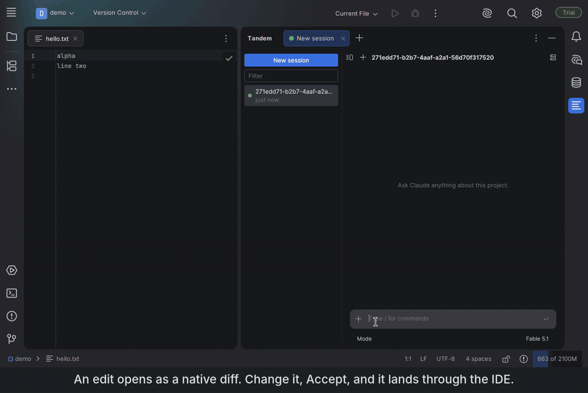

[English](README.md) | **简体中文** | [日本語](README.ja.md) | [한국어](README.ko.md)

# Tandem

一款适用于 Claude Code 的快速、原生 JetBrains 插件。免费且开源。



> 状态：早期阶段。自 0.4.1 起已上架 [JetBrains Marketplace](https://plugins.jetbrains.com/plugin/35641-tandem)。
> 目前支持 macOS 和 Linux；Windows 支持正在开发中。
> 编辑经由 IDE 完成：在 Tandem 中，CLI 自带的 Edit 和 Write 工具被禁用，改由 Tandem 提供自己的编辑工具。可编辑的 diff 已通过回放真实录制内容的模拟 CLI 测试，并在 macOS 上手动测试过；难免还有不完善之处。

## 为什么用 Tandem
- **原生界面。** 基于 IDE 自身的工具包 Jewel（Compose）构建，而不是内嵌浏览器。
- **不需要 Node，不捆绑 SDK。** Tandem 直接驱动你已经安装的 `claude` CLI，因此 CLI 发布新模型和新功能的当天就能用上。
- **编辑经由 IDE。** Claude 提出的每一处编辑在写入之前，都会先在 IDE 自己的 diff 中打开，你可以在那里手动修改提议的内容。Accept 会通过编辑器应用它，并告诉 Claude 文件现在的内容，包括你做的改动；Reject 会把你的理由发给 Claude。使用 Accept edits 模式，或在 diff 中点击 Accept all（在该轮剩余时间内有效），则会跳过 diff。
- **如实显示状态。** 如果你选的模型不可用、CLI 回退到了另一个模型，你会看到。
- **登录信息留在 CLI。** Tandem 从不读取凭据或 API 密钥。

## 你能得到什么
- **一个属于 IDE 的聊天工具窗口。** 会话列在侧边栏中，每个活动会话一个标签页；可以重命名、分叉和删除；在终端中启动的会话也会出现在侧边栏，并通过 CLI 自带的 `--resume` 恢复。
- **可编辑的 diff。** 按 Ctrl+S（⌘S）接受；由于写入始终经过编辑器、从不直接写入磁盘，撤销、本地历史和未保存的缓冲区都照常工作。
- **模型、推理强度和权限模式选择器，如实显示实际情况。** Tandem 会核对 CLI 报告的模型，与你所选不同或发生回退时，会在聊天中说明；Shift+Tab 循环切换权限模式。
- **权限卡片、提问、MCP 服务器、斜杠命令、`! command`。** 在聊天中批准工具调用，回答 Claude 的提问，在面板中开关 MCP 服务器并登录，运行 shell 命令并把输出交给 Claude。
- **看得见的上下文。** `@` 选择项目文件（包括未保存的更改），编辑器中的选区以标签形式随消息一起发送，上下文环可打开上下文窗口的占用明细，`/usage` 显示本会话的费用和你所用套餐的用量限制。
- **Claude 工作时也能发送，或排队到本轮结束后再发**（Ctrl+Enter，⌘↵）；排队中的消息可以编辑或取消。

## 工作原理
Tandem 以 `--output-format stream-json --input-format stream-json` 启动你安装的 `claude` 可执行文件，并用 Jewel 渲染它流式输出的内容。它的编辑工具是一个 SDK MCP 服务器，CLI 通过同一个控制通道访问它。除此之外不运行任何东西：没有 Node，没有 sidecar，没有浏览器。[docs/protocol.md](docs/protocol.md) 按 CLI 实际的通信方式描述了该协议。

## 体积
0.4.1 的 ZIP 为 4.0 MB：四个 jar，没有 Node，没有 webview，没有原生库。测量 Marketplace ZIP 的脚本，以及其他适用于 Claude Code 的插件的数据，见 [docs/benchmarks.md](docs/benchmarks.md)。在 IDE 测试中，从侧边栏打开一个 1000 轮的对话耗时 1.4 秒，界面没有卡顿（见同一文档）。首个 token 的响应时间和内存占用尚未测量。

## 系统要求
- JetBrains IDE 2026.1 或更新版本。
- 已安装并登录 [Claude Code](https://code.claude.com)（在终端中能运行 `claude --version`）。

### 使用中转或第三方接口
Tandem 启动你安装的 `claude` 时，所用的环境与 CLI 在终端中看到的一致，因此 CLI 已有的配置原样生效：无论是登录信息，还是在 `~/.claude/settings.json` 的 `env` 中设置、或在 shell 中导出的 `ANTHROPIC_BASE_URL` 和 `ANTHROPIC_AUTH_TOKEN`。Tandem 自身没有任何服务商设置，也从不读取这些值；通过改写 `settings.json` 来切换 CLI 服务商的工具，会在下一次启动会话时生效。

如果原生安装程序无法下载，可以用 npm 安装 CLI：
```bash
npm install -g @anthropic-ai/claude-code
# npm 官方源较慢时：
npm install -g @anthropic-ai/claude-code --registry=https://registry.npmmirror.com
```

Tandem 的选择器和底栏中显示的模型，就是 CLI 报告的模型；如果中转服务会映射模型名称，显示的是 CLI 报告的名称。

## 安装
在 Settings | Plugins | Marketplace 中搜索 **Tandem**，或打开 [plugins.jetbrains.com/plugin/35641-tandem](https://plugins.jetbrains.com/plugin/35641-tandem)。然后打开 Tandem 工具窗口，输入提示词即可。

## 从源码构建
```bash
./gradlew runIde        # 带插件的沙盒 IDE
./gradlew test          # 单元测试和协议 fixture 测试
./gradlew buildPlugin   # ZIP 生成在 build/distributions/
```
通过 Settings | Plugins | ⚙ | Install Plugin from Disk 安装该 ZIP。

## 用 Claude Code 开发 Tandem
运行一次 `./scripts/setup-agent.sh`。它会安装本仓库需要的插件、语言服务器和文档服务器。然后阅读 `CLAUDE.md`、`docs/design.md` 和 `docs/protocol.md`。

## 许可证
Apache 2.0。Tandem 是独立项目，与 Anthropic 或 JetBrains 无关联，也未获得其认可。
Claude 和 Claude Code 是 Anthropic, PBC 的商标。
